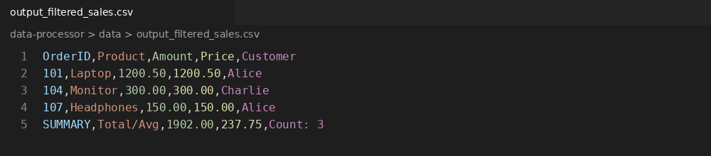
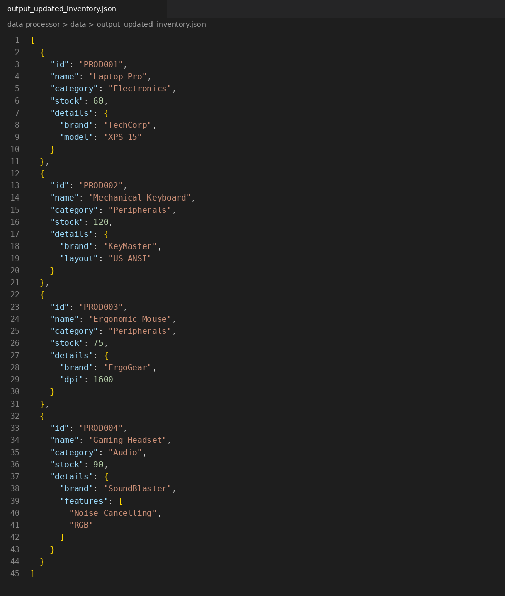

# Week 8 LabX BASIC: Automating with CSV and JSON Data

**ชื่อ:** เมธาวี สิทธิชัยเนตร  
**รหัสนักศึกษา:** 663380372-6

โปรเจคนี้ใช้ Python (`csv`, `json`) อ่าน ประมวลผล และเขียนไฟล์ CSV และ JSON

## Screenshots

### ภายในไฟล์ `data/output_filtered_sales.csv`


### ภายในไฟล์ `data/output_updated_inventory.json`


## โครงสร้างโปรเจค

```
data-processor/
├── src/
│   ├── __init__.py
│   ├── csv_handler.py        # อ่าน/เขียน/ประมวลผล CSV
│   ├── json_handler.py       # อ่าน/เขียน/แก้ไข JSON
│   └── utils.py              # logging และสร้างโฟลเดอร์
├── data/
│   ├── input_sales.csv
│   ├── output_filtered_sales.csv
│   ├── input_inventory.json
│   └── output_updated_inventory.json
├── screenshots/
├── main.py
├── .gitignore
└── README.md
```

## วิธีรัน

ไม่ต้องติดตั้ง package เพิ่ม (ใช้ standard library ของ Python)

```
python main.py
```

## ผลลัพธ์

**CSV:** อ่านยอดขาย 8 รายการ คำนวณ Total Sales = 1902.00, Average Item Price = 237.75
แล้วกรองรายการที่ Amount >= 100 ได้ 3 รายการ (Laptop, Monitor, Headphones) พร้อมแถว SUMMARY
บันทึกลง `data/output_filtered_sales.csv`

**JSON:** อ่าน inventory แล้วอัปเดต stock ของ PROD001 เป็น 60, PROD003 เป็น 75
และเพิ่มสินค้าใหม่ PROD004 (Gaming Headset) บันทึกลง `data/output_updated_inventory.json`
